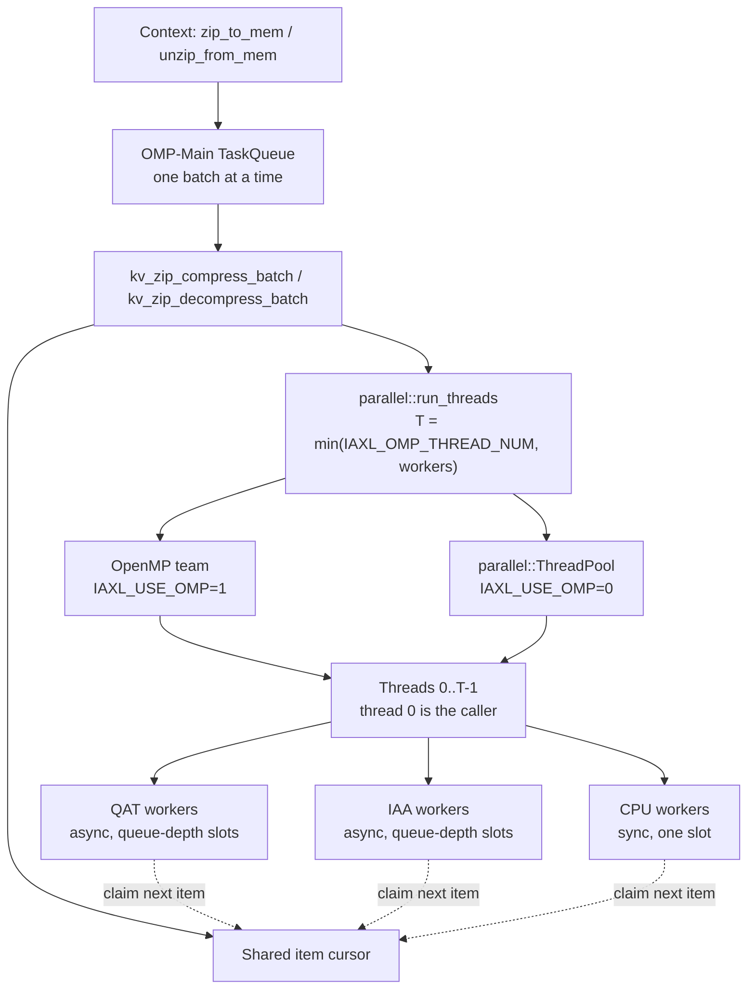
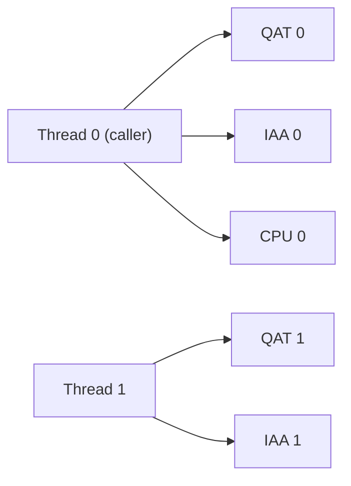

# KV Zip Design

## Purpose

`kv_zip` compresses and decompresses batches of KV chunks for the native `Context`. Each batch is spread over all enabled DEFLATE backends at the same time: Intel QAT, Intel IAA, and CPU zlib workers. A configurable number of host threads drives the backends, so the accelerators can be kept busy without a dedicated CPU core for every accelerator instance.

| Code | Role |
| --- | --- |
| `iaxl/csrc/kv_zip/kv_zip.cpp` | Batch pipeline and block format |
| `iaxl/csrc/include/parallel.h`, `iaxl/csrc/common/parallel.cpp` | Generic `run_threads`, `parallel_for`, and `ThreadPool` |
| `iaxl/csrc/{qat,iaa,cpu}_zip/` | Backends with slot-based `compress` / `decompress` / `wait` |

## Architecture

All batches run on the single `OMP-Main` queue thread, one at a time. Decompression is queued at high priority and compression at low priority. Because batches never overlap, two batches never share a backend slot. The queue thread also takes part in its own batch as thread 0.

## Workers and Threads

A **worker** is one backend instance together with its slots:

- Each QAT or IAA instance keeps `queue_depth` asynchronous requests in flight.
- A CPU worker has a single slot and finishes its zlib request inside the submit call.

Workers are numbered QAT first, then IAA, then CPU. Thread `t` owns workers `t, t+T, t+2T, …`. Each instance is therefore polled by exactly one thread, so instances need no locking. The example below uses 2 QAT, 2 IAA and 1 CPU worker with `T = 2`.

Every thread runs the same loop over its slots:

1. **Fill:** claim items from the shared cursor and submit one item per slot. Before submitting, compression applies optional lossy truncation and a BF16 byte shuffle to the data in place.
2. **Poll:** go round the in-flight slots calling the backend's `wait(..., non_block=1)`. A result of `IAXL_ZIP_PENDING` moves on to the next slot.
3. **Refill:** when a request completes, finish its item. For compression this means writing the block header; for decompression it means copying the data out and undoing the shuffle. Then claim the next item and resubmit it into the same slot. A slot is retired once the cursor is empty.

Items are claimed as requests complete instead of being split up front, so faster backends automatically take a larger share of the batch. Polling never blocks, which allows `T` to range from 1 up to the worker count. At `T = 1` the caller drives every worker alone. Using fewer threads gives up some throughput but leaves more CPU cores free for inference.

## Block Format and Routing

Every stored block starts with an 8-byte header in front of its payload.

| Word | Content |
| --- | --- |
| 0 | Payload length; bit 31 is set when IAA produced the stream |
| 1 | Original byte size; `0` marks a raw (uncompressed) block |

Decompression routes each block by its header:

- Raw blocks are copied with `parallel::parallel_for`.
- IAA-produced blocks go only to IAA workers.
- All other blocks go to QAT or CPU workers.

IAA and QAT/CPU blocks are tracked with two separate cursors. Batches stored without compression (`IAXL_KV_COMPRESSION=0`, or leading layers that bypass compression) use the raw path in both directions.

## Threading Runtime

`parallel.h` contains no zip-specific code, so any module can use it:

- `run_threads(n, fn)` calls `fn(tid)` concurrently for every `tid` in `[0, n)`. When `n == 1`, it runs `fn` on the caller without starting a parallel region.
- `parallel_for(n, body)` lets up to `IAXL_OMP_THREAD_NUM` threads claim indices from an atomic counter.
- `ThreadPool` holds the persistent threads that `run_threads` uses when OpenMP is off.

`IAXL_USE_OMP` selects the runtime:

| `IAXL_USE_OMP` | Runtime | Behavior |
| --- | --- | --- |
| `1` (default) | OpenMP `parallel num_threads(n)` | Shares libgomp and the `OMP_*` settings with torch and vLLM. Idle threads spin briefly, which gives the lowest wake-up latency. |
| `0` | `parallel::ThreadPool` | Creates `IAXL_OMP_THREAD_NUM - 1` threads named `POOL-<tid>` on first use; the caller acts as thread 0. Idle threads sleep on a condition variable, and the pool is independent of vLLM's use of OpenMP. |

The pool runs one team at a time. A nested run on the same pool aborts instead of deadlocking. The pool is never destroyed, so work still in flight when the process exits keeps valid state.

## Configuration

| Variable | Meaning |
| --- | --- |
| `IAXL_QAT_ZIP_ENABLE`, `IAXL_IAA_ZIP_ENABLE`, `IAXL_CPU_ZIP_ENABLE` | Enable each backend |
| `IAXL_QAT_INSTANCE_NUM`, `IAXL_IAA_INSTANCE_NUM`, `IAXL_CPU_ZIP_THREADS` | Number of workers per backend |
| `IAXL_QAT_ZIP_QUEUE_DEPTH`, `IAXL_IAA_ZIP_QUEUE_DEPTH` | In-flight requests per QAT / IAA worker (≤ 4) |
| `IAXL_OMP_THREAD_NUM` | Thread count `T`. Defaults to the worker count and must be between 1 and the worker count. Also exported as `OMP_NUM_THREADS` and `OMP_THREAD_LIMIT`. |
| `IAXL_USE_OMP` | `1` for OpenMP, `0` for `ThreadPool` |

`setvars.sh` derives the defaults, and `tools/auto_config.sh` rejects inconsistent combinations.
